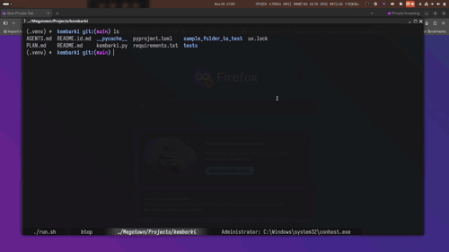

# kembarki

english · [bahasa indonesia](README.id.md)



## about the project

kembarki means "theyre the same". i made this because my backups had soooo many dups lol. i have these files in the parent folder but i have the same shit in the nested dir too. imagine having like backups1, backups2, and inside one of them theres backups45 you accidentally pasted in there. yeah.

so this thing goes through a folder and every folder inside it, finds files with the same name, and gives you a nice html report. you open it in your browser and see whats doubled, how big it is, and where every copy lives.

it only looks, it doesnt touch. no deleting, no moving, no renaming. it doesnt even open your files, it just reads the name, size and date. so even 10gb+ videos are checked instantly.

## setup

```
python -m venv .venv
source .venv/bin/activate
pip install -r requirements.txt   # only needed if you wanna run the tests
```

### if you use uv package manager like me, even better

```
uv venv
source .venv/bin/activate
uv pip install -r requirements.txt
```

or skip the activate thing and just do `uv run kembarki.py ./folder/you/want`

## how to use

### 1. quick and basic

```
python kembarki.py ./folder/you/want
```

thats it. it makes `kembarki-report.html` right where you ran it, open it in your browser.

wanna try it first before pointing it at your real backups? theres a sample folder in the repo, 3 levels deep with a bunch of animal .txt files duplicated everywhere (yes the monkey goes uu aa). theres even a `backups45` sitting inside `backups1/2024`, just like real life.

```
python kembarki.py ./sample_folder_to_test
```

you should get 18 duplicate names, some **same size** and some **size differs**.

### 2. advanced usage

```
python kembarki.py ./sample_folder_to_test/backups1 ./sample_folder_to_test/backups2 -o dupes.html
python kembarki.py ./sample_folder_to_test --exclude backups45 --exclude "notes.txt"
python kembarki.py ./sample_folder_to_test --min-size 30B --ignore-case
python kembarki.py ./sample_folder_to_test --layout table
python kembarki.py ./sample_folder_to_test --csv dupes.csv --json dupes.json
```

first one compares two folders against each other, second one skips the `backups45` mess and all the notes, third one only looks at files 30 bytes and up.

| option | what it does |
|---|---|
| `-o FILE` | where to save the html report (default `kembarki-report.html`) |
| `--layout grouped` or `table` | which view the report opens in, you can switch it in the page anyway |
| `--csv FILE`, `--json FILE` | extra reports if you want them for a spreadsheet or something |
| `--ignore-case` | treats `Photo.JPG` and `photo.jpg` as the same |
| `--min-size SIZE` | skips small files (`500K`, `10M`, `1G`) |
| `--exclude PATTERN` | skips files or folders that match, you can use it more than once |
| `--follow-symlinks` | follows links, off by default |
| `-q` | no progress text |

## the report

- every name that shows up more than once, with size, date and location of each copy
- **same size** means its probably the same file, **size differs** means maybe not
- biggest space wasters on top
- grouped view or table view, switch anytime
- search box, file type filter (video, image, audio, etc) and same size / differs filter
- click the column headers to sort

heads up: it matches by name only for now. checking actual file contents (hashing) is in the backlog, see `PLAN.md`.

## tests

```
pytest
```
